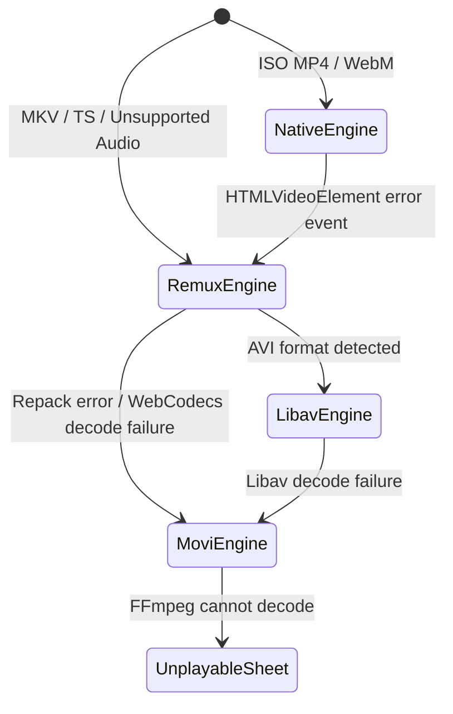

# TMPlayer Web: Telegram File Playback, Streaming, Buffering, and Seeking Architecture

This document provides a comprehensive end-to-end breakdown of the web playback pipeline in TMPlayer: from the initial user click on "Play" to MTProto chunk fetching, Service Worker range request interception, multi-engine routing (Native, MSE Remux, WebCodecs/FFmpeg WASM), sliding buffer management, and keyframe-aligned seeking mechanics.

---

## 1. Overall Flow Architecture

```mermaid
flowchart TD
    A["User Clicks Play in UI (Detail / VideoList)"] --> B["Watch.tsx Route Loader"]
    B -->|warmFile| C["TgFile Prefetch (Head + Tail Chunks)"]
    B --> D["Player.tsx Component Mount"]
    D --> E["probe(): mediabunny inspects container & codecs"]
    E --> F{Engine Router: route()}
    
    F -->|ISO MP4/WebM + Supported Codec| G["Native Engine: <video src='/stream/...'>"]
    F -->|MKV / TS / Unsupported Audio / HEVC| H["Remux Engine: FeedEngine + MSE SourceBuffer"]
    F -->|AVI container| I["Libav Engine: libav.js WASM + MSE"]
    F -->|Unsupported by MSE / Remux Failure| J["Movi Engine: FFmpeg WASM + Canvas + Web Audio"]
    
    G --> K["Service Worker (/sw.js) Intercepts /stream/"]
    K -->|postMessage 'read'| L["streams.get(key): TgFile.read(start, end)"]
    H -->|mediabunny CustomSource| L
    I -->|file.read| L
    J -->|TgSource.read| L
    
    L --> M["TgFile (512 KiB Chunks, Parallel=4, Memory Budget)"]
    M -->|call('chunk') via rpc.ts| N["Telegram Web Worker (worker.ts)"]
    N -->|tg.call('upload.getFile')| O["Telegram MTProto Servers (Data Centers)"]
```

---

## 2. Step 1: User Click to Play and Early Warming

### 2.1 Triggering Playback
Playback can be initiated from:
- `Detail.tsx` (`play(from)`): Navigates to `watchPath(item)` (`/watch/${item.chatId}/${item.messageId}`) with `{ state: { video: item } }`.
- `VideoList.tsx` (Cards / Tiles / Continue Watching): Navigates to `/watch/...`.
- `Detail.tsx` on mount already calls `warmFile(item)` on the assumption that "Play" is the most likely next user action.

### 2.2 Watch Route Handling (`webapp/src/screens/Watch.tsx`)
- Reads route parameters: `chatId` and `messageId`.
- Resolves the `VideoItem`:
  - If `location.state?.video` is passed and `api.known(passed.key)` is true, it reuses the in-memory item without an extra network call.
  - Otherwise, queries Telegram RPC: `api.video(chatId, messageId)`.
- **Pre-warming (`warmFile`)**:
  - As soon as the video metadata is confirmed, `warmFile(found)` runs immediately while the player module (`Player.tsx`) is lazy-loaded asynchronously via `lazy(loadPlayer)`.
  - Next episode prefetching: When within 30 seconds of video completion (`NEXT_AHEAD = 30`), `warmFile(next)` is triggered automatically.

---

## 3. Step 2: The Telegram Data Transport Pipeline

The web application runs Telegram network operations inside a dedicated Web Worker to isolate MTProto processing and cryptographic operations from the main UI thread.

### 3.1 Session Locks and Single-Tab Ownership (`webapp/src/tg/rpc.ts`)
- Uses the Web Locks API (`navigator.locks.request('tmplayer-telegram', ...)`).
- Only one browser tab is permitted to hold the active MTProto connection. Other tabs display a waiting state and pause playback to prevent state corruption.
- Communication with `worker.ts` uses an RPC message protocol with an auto-incrementing `id` and `AbortSignal` propagation.

### 3.2 Telegram File Location and Metadata (`webapp/src/tg/media.ts`)
When messages are parsed:
- Each video or document is registered in `files = new Map<string, FileLoc>()` with:
  - `location: tl.TypeInputFileLocation` (`inputDocumentFileLocation` containing `id`, `accessHash`, `fileReference`, `thumbSize`).
  - `dcId`: Data center ID hosting the media.
  - `size`: Total byte size.
  - `chatId`, `messageId`: Location coordinates for reference refreshing.
- Checks `alt_documents` to extract Telegram-transcoded copies (e.g. 720p, 480p, 360p) and storyboard sprites.

### 3.3 MTProto Chunk Fetching (`webapp/src/tg/worker.ts`)
The worker implements the `chunk` method:
- Calls MTProto method `upload.getFile`:
  ```ts
  tg.call(
      { _: 'upload.getFile', location: f.location, offset, limit },
      { dcId: f.dcId, kind: 'download', abortSignal: ctx.signal, floodSleepThreshold: 30 }
  )
  ```
- **Expired File References (`FILE_REFERENCE_*`)**:
  Telegram file references expire periodically. When an error matching `FILE_REFERENCE_` occurs, the worker fetches `tg.getMessages(f.chatId, f.messageId)` to obtain fresh references, updates `f.location`, and retries.
- **Data Center Redirection (`FILE_MIGRATE_%d`)**:
  If a file has migrated to a different DC, the worker captures `err.newDc`, updates `f.dcId`, and retries.
- **Connection Pre-warming (`warmDcs`)**:
  Sends a 4 KB probe (`upload.getFile` offset 0, limit 4096) to target DCs ahead of time to complete the TLS handshake before playback starts.

---

## 4. Step 3: Virtual File Manager (`TgFile` in `webapp/src/stream/reader.ts`)

`TgFile` acts as a random-access virtual file system over Telegram's MTProto chunk protocol.

### 4.1 Chunk Specifications and Sizing
- **Chunk Size**: Fixed at **512 KiB** (`512 * 1024`).
- **Alignment**: Every read offset is aligned to a multiple of 512 KiB so no request crosses a 1 MiB boundary (an MTProto download constraint).
- **Parallelism**: Up to `PARALLEL = 4` chunks are requested concurrently (yielding approximately 2 to 3.5 MB/s throughput with low latency).

### 4.2 Cache Budget and Eviction Policy
- **Budget**: 48 MiB on mobile devices (`pointer: coarse`), 128 MiB on desktop.
- **Immutable Bounds**: Chunk 0 (head) and chunk `N - 1` (tail, or last 2 chunks if size > 256 MiB) are **never** evicted. They contain container headers (`moov` in MP4, `EBML`/`Cues` in MKV).
- **Eviction**: When `total > MEMORY_BUDGET`, `evictOne()` drops the oldest accessed intermediate chunks.

### 4.3 Warming Strategy (`warmUp`)
When `warmUp()` runs:
1. Immediately requests Chunk 0 (urgent: true).
2. Immediately requests Tail chunk(s) (urgent: true).
3. Speculatively fetches Chunks 1 to 3 (urgent: false).

### 4.4 Priority Scheduling and Job Queue
Every chunk request creates a `Job`:
```ts
interface Job {
    index: number
    urgent: boolean
    abort: AbortController
    promise: Promise<Uint8Array>
    resolve: (b: Uint8Array) => void
    reject: (e: unknown) => void
    started: boolean
}
```
- `pickNext()` selects unstarted jobs prioritizing:
  1. `urgent === true` (data the player is blocking on).
  2. Lower chunk index over higher chunk index.
- Read-ahead window: Dynamically sized between 6 MiB and 16 MiB (`Math.min(16 MiB, Math.max(6 MiB, bitrate * 30))`), roughly 30 seconds of playback buffer.
- Sequential reads (`inOrder`) trigger `ahead(last + 1)`.
- If paused for longer than 60 seconds, `wantAhead` is toggled off.

### 4.5 Telegram Rate Limiting (Flood Waits)
If Telegram responds with `FLOOD_WAIT_X` (where X <= 60 seconds):
- The specific chunk sleeps for `X * 1000 + 250 + random(500)` ms and retries up to 5 times.
- Other parallel chunk requests continue unhindered.

---

## 5. Step 4: The Service Worker Streaming Bridge (`webapp/public/sw.js`)

HTML5 `<video>` elements require an HTTP endpoint supporting byte-range requests (`HTTP 206 Partial Content`) for native hardware decoding.

### 5.1 Request Interception
- `sw.js` listens to `fetch` events matching `/stream/<key>?size=<size>&mime=<mime>`.
- Parses the HTTP `Range` header:
  - Standard range: `bytes=start-end`.
  - Suffix range: `bytes=-N` (reads last N bytes).
- Clamps response payload to `MAX_ANSWER = 2 MiB`.

### 5.2 Bridge to Window
- Finds the active window client via `clients.matchAll({ type: 'window' })`.
- Sends a `MessageChannel` event:
  `client.postMessage({ type: 'read', key, start, end }, [channel.port2])`
- `serveStreams()` in `webapp/src/stream/reader.ts` receives the event:
  - Looks up the `TgFile` in `streams: Map<string, TgFile>`.
  - Executes `await file.read(msg.start, msg.end + 1)`.
  - Transfers the underlying buffer back via `port.postMessage({ bytes: copy }, [copy])`.

### 5.3 HTTP 206 Response Construction
`sw.js` constructs a synthetic `Response`:
- Status: `206 Partial Content`
- Headers:
  - `Content-Range: bytes ${start}-${start + bytes.byteLength - 1}/${size}`
  - `Content-Length: String(bytes.byteLength)`
  - `Content-Type: mime`
  - `Accept-Ranges: bytes`
  - `Cache-Control: no-store`

---

## 6. Step 5: Media Probing and Engine Selection (`Player.tsx`, `engines.ts`)

When `Player.tsx` opens a file, it probes container metadata before deciding how to play:

### 6.1 Probing (`probe()` in `engines.ts`)
- Wraps `TgFile` in mediabunny's `CustomSource`:
  ```ts
  new Input({
      formats: ALL_FORMATS,
      source: new CustomSource({
          getSize: () => file.size,
          read: (start, end) => file.read(start, end),
          maxCacheSize: 4 * 1024 * 1024,
          prefetchProfile: 'fileSystem',
          handleUnhandledError: () => {},
      })
  })
  ```
- Reads container format (`Mp4InputFormat`, `WebMInputFormat`, `MpegTsInputFormat`, etc.).
- Inspects primary video track, audio tracks, duration, base start timestamp, and codec parameter strings.
- Detects non-mediabunny containers via binary signature sniffing: AVI (`RIFF....AVI`), WMV, FLV, RealMedia, MPEG-PS.

### 6.2 Decision Matrix (`route()`)

| Condition | Selected Engine | Playback Pipeline |
| :--- | :--- | :--- |
| ISO MP4 / QuickTime / WebM, browser reports `canPlayType(mime) !== ''`, Service Worker active | **Native Engine** | Direct `<video src='/stream/...'>` via Service Worker |
| MKV / TS / MP4 with unplayable audio (AC-3/DTS) or MSE-compatible video | **Remux Engine** | Mediabunny remuxes to fMP4 on the fly -> `MediaSource` `SourceBuffer` |
| HEVC video where browser MSE lacks native HEVC decoding, but WebCodecs H.264 encoder is supported | **Remux Engine (Transcode)** | Mediabunny demux -> `hevc.js` WASM decode -> WebCodecs H.264 encode -> MSE |
| AVI container | **Libav Engine** | `libav.js` (FFmpeg WASM) worker demux/decode -> fMP4 -> MSE |
| Remux failures, unplayable video codecs, or broken streams | **Movi Engine** | `movi-player` (FFmpeg WASM + WebCodecs) -> Canvas + Web Audio |

---

## 7. Step 6: Buffering and Feeding (`FeedEngine` & `RemuxEngine`)

`FeedEngine` manages feeding fragmented MP4 (fMP4) streams into `MediaSource` / `ManagedMediaSource` (Safari/iOS).

### 7.1 Sliding Buffer Window (`roomAhead`)
- Tracks current playback position `t = video.currentTime`.
- Scans `SourceBuffer.buffered` to find buffer end.
- Target forward buffer:
  - **30 seconds** on mobile (`pointer: coarse`).
  - **60 seconds** on desktop.
- When forward buffer reaches the limit (or `ManagedMediaSource` pauses streaming on low battery), `roomAhead` suspends production until `timeupdate`, `play`, or a 1-second timer fires.

### 7.2 Quota Eviction
If the browser throws `QuotaExceededError` during `SourceBuffer.appendBuffer()`:
- Automatically purges buffered content behind playback:
  `sb.remove(0, video.currentTime - 10)`
- Waits for `updateend` and retries appending.

### 7.3 Audio Remuxing and Transcoding
- **Pass-through**: If the audio track is supported in MP4 (e.g. AAC, or Opus in browsers supporting `audio/mp4; codecs="opus"`), packets are copied without modification.
- **Conversion**: If audio is AC-3, E-AC-3, or DTS:
  - Loads `@mediabunny/ac3` or `@mediabunny/dts` WASM decoders.
  - Encodes to AAC via browser WebCodecs `AudioEncoder` or mediabunny's WebAssembly AAC encoder (`@mediabunny/aac-encoder`).

---

## 8. Step 7: Seeking Mechanics and Keyframe Alignment

Seeking involves coordinated behavior across UI, buffering, demuxing, and network layers:

### 8.1 UI Scrubbing and Debouncing (`Chrome.tsx`)
- Dragging the seek bar sets `dragTime(t)` for instant visual feedback.
- Fine-scrubbing on touch screens: Vertical distance from the bar decreases scrub speed (`fineRate(deltaY)`), enabling sub-second adjustments.
- Seek execution is debounced with `SEEK_SETTLE_MS = 120ms` so dragging across the bar does not flood the player with seeks.

### 8.2 In-Buffer vs Out-of-Buffer Seeks (`FeedEngine.seekTo`)
- `isBuffered(targetTime)`:
  Checks whether `targetTime` falls within existing `SourceBuffer.buffered` ranges (`target >= start - 0.1 && target < end - 0.3`).
- **In-Buffer Seek**: The browser seeks internally; the demuxing pipeline continues feeding without interruption.
- **Out-of-Buffer Seek**:
  1. Increments run generation (`gen++`).
  2. Cancels active `Conversion` via `conversion.cancel()`.
  3. Aborts and flushes `SourceBuffer` (`sb.abort()`, `sb.remove(0, Infinity)`).
  4. Queries keyframe index:
     `keySink.getKeyPacket(targetTime + base, { metadataOnly: true })`
  5. Determines keyframe timestamp `from`.
  6. Initializes new `Conversion` trimmed to `trim: { start: from }`.
  7. Sets `SourceBuffer.timestampOffset = from - base`.
  8. Emits initialization segment (`ftyp` + `moov`) followed by media fragments (`moof` + `mdat`).

### 8.3 Network Job Cancellation on Seek (`TgFile.dropFarJobs`)
When seeking to a new offset:
- Computes new chunk range `[first, last]`.
- Enforces `dropFarJobs(first, last)`:
  - Iterates all pending jobs.
  - Aborts (`job.abort.abort()`) and deletes any non-urgent job where `job.index < first || job.index > last + keep`.
  - Rejects with `AbortError`.
- **Result**: Cancels unnecessary downloads instantly, freeing all 4 network worker slots for the new seek position.

### 8.4 Seek Previews and Storyboards
- **Telegram Storyboards (`storyboard.ts`)**:
  Downloads `application/x-tgstoryboard` (JPEG tile sprite) and `application/x-tgstoryboardmap`. `frameAt(frames, seconds)` computes exact pixel offsets `(x, y)` to display instant preview cards above the seek bar.
- **Native Frame Grabber (`seekpreview.ts`)**:
  When playing natively without storyboards, `FrameGrabber` uses an offscreen hidden `<video>` element to capture canvas frames at 120 quantized slots across the file.

---

## 9. Error Recovery, Stalls, and Engine Fallback



1. **Native to Remux Fallback**:
   If the native `<video>` element emits an error event on a file originally identified as native, `onVideoError()` catches it, destroys `nativeEngine`, and transfers playback to `RemuxEngine` at the exact same timestamp.
2. **Remux to Movi Fallback**:
   If `SourceBuffer` append fails, a codec parameter is rejected, or repacking stalls, `remuxFailed()` destroys `RemuxEngine` and initializes `MoviEngine` at `video.currentTime`.
3. **Movi Element Proxying (`takeOver`)**:
   `MoviEngine` overlays an HTML5 canvas over the `<video>` element and proxies all properties (`currentTime`, `duration`, `paused`, `playbackRate`, `buffered`, `readyState`) so UI controls and keyboard shortcuts function transparently.
4. **Stall Watchdog**:
   `Player.tsx` samples playback every second. If `readyState < 3` with clock stationary for more than 15 seconds (`STALL_MS = 15_000`), a stall card appears giving options to Retry, switch Quality, or Go Back.
